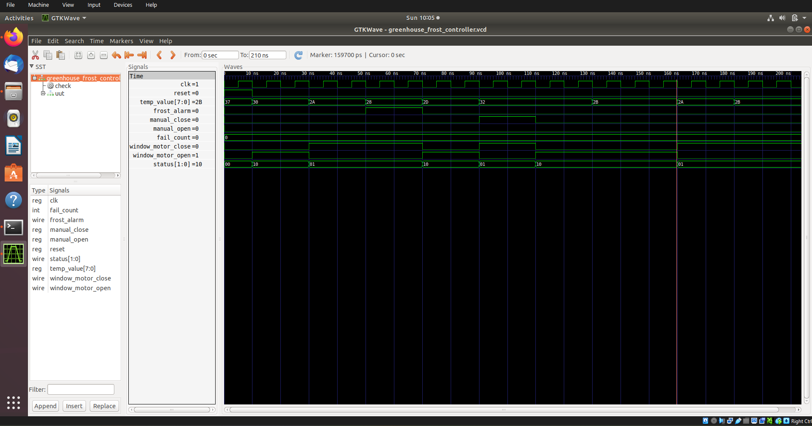
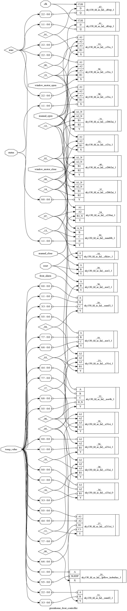
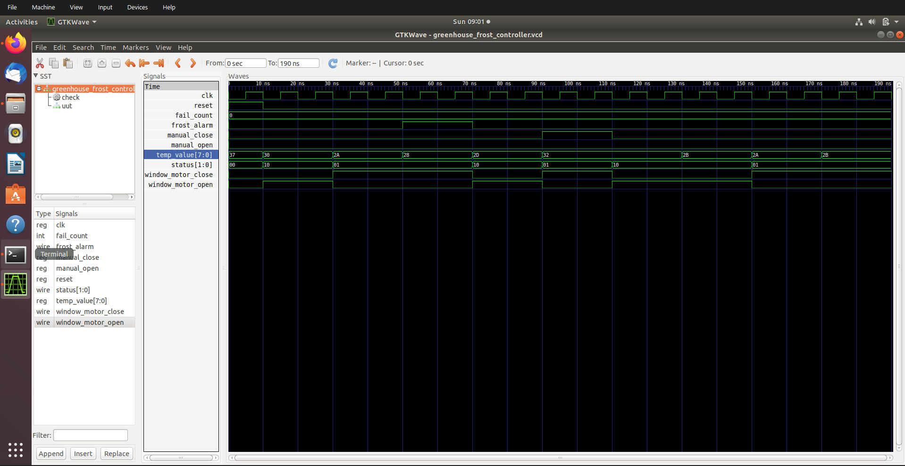
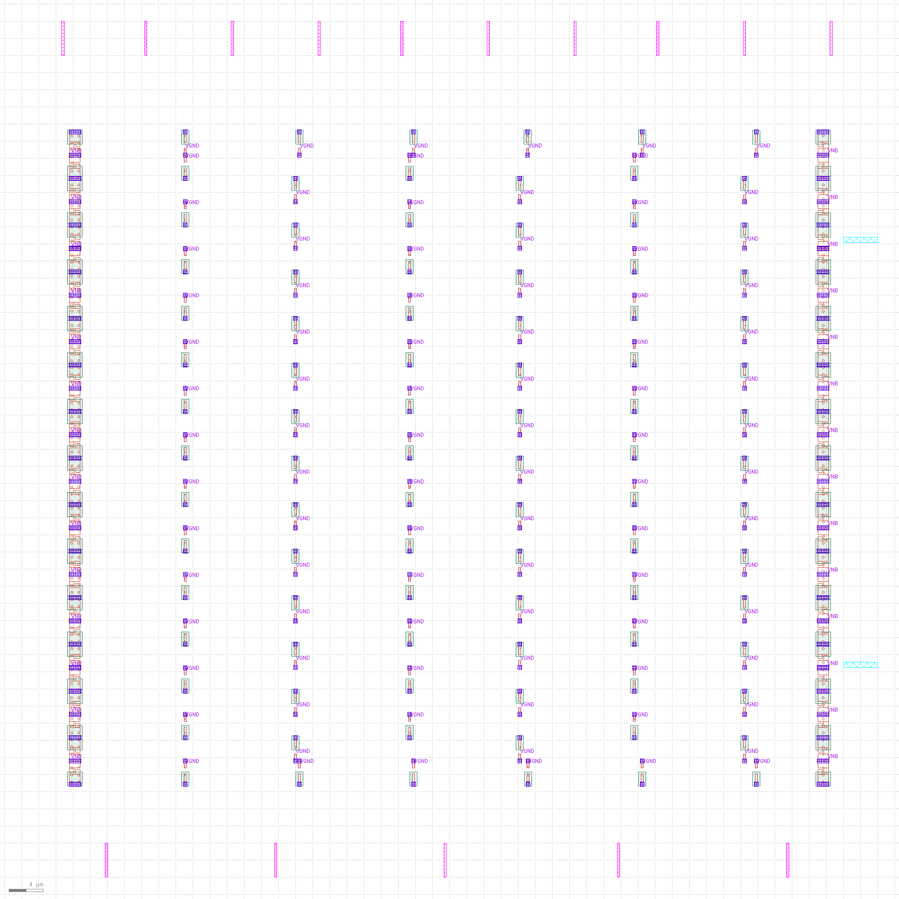
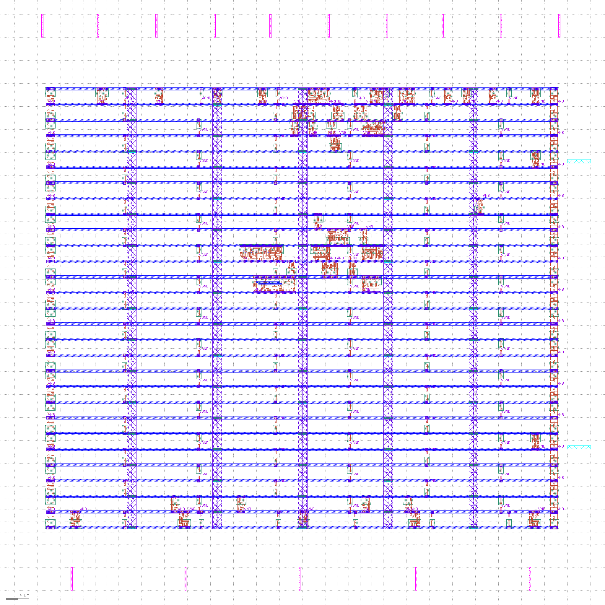
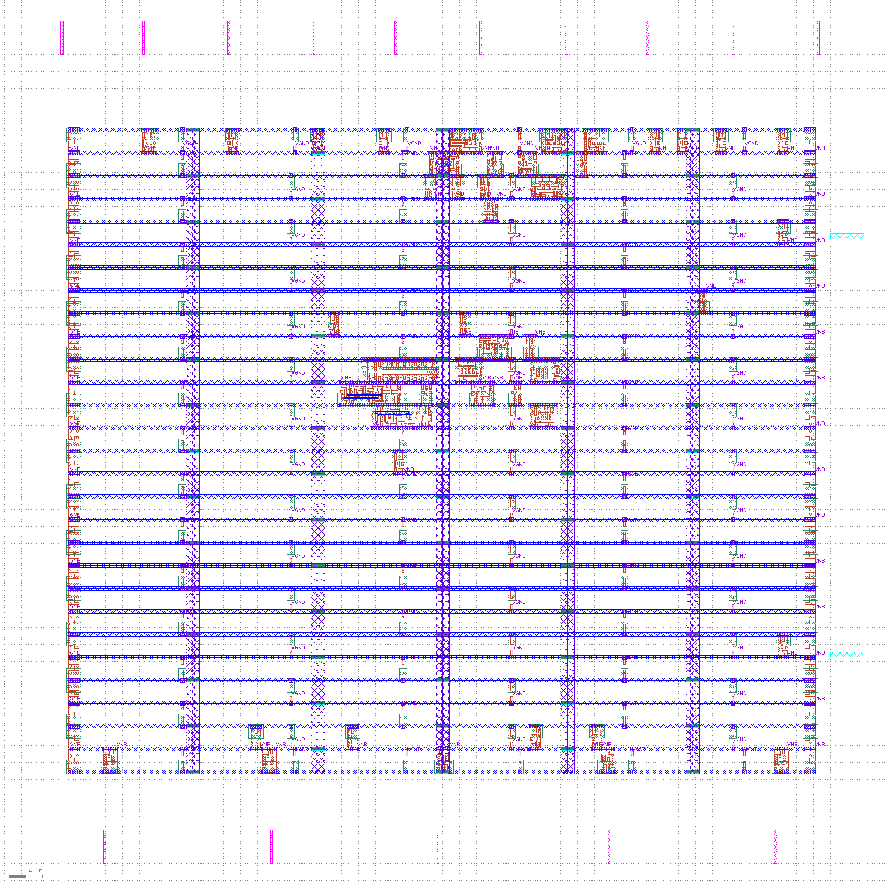
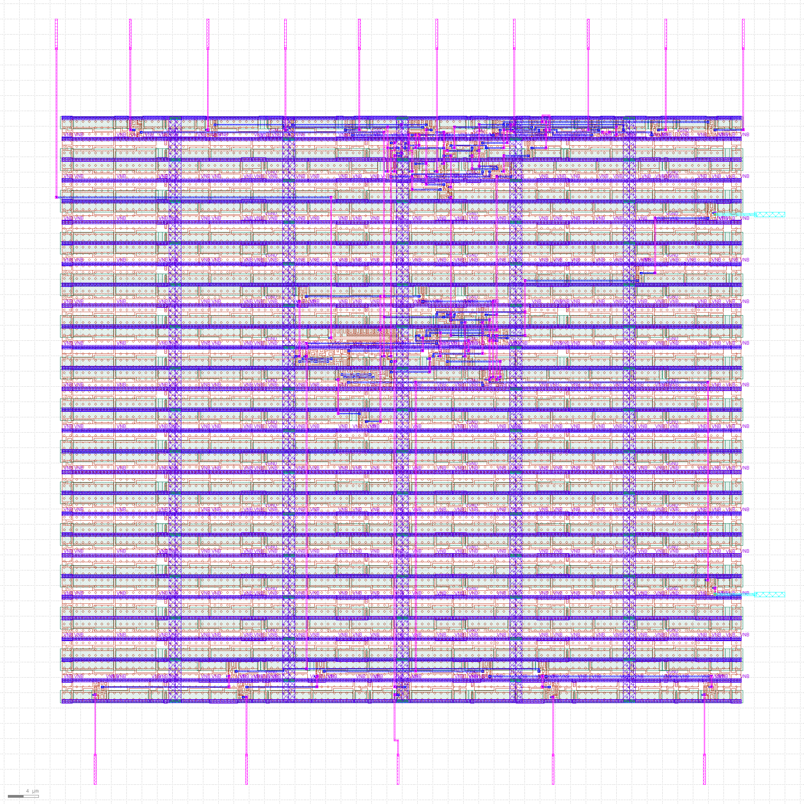
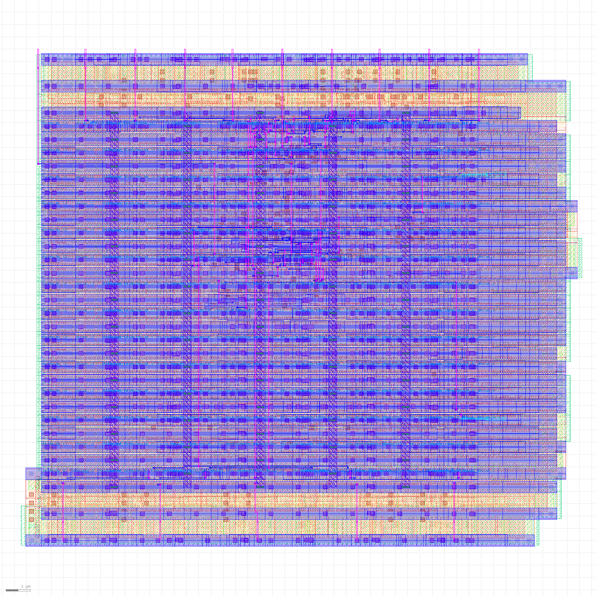

# 🌱 Greenhouse Frost Protection Window Controller


**RTL-to-GDSII ASIC design on SkyWater SKY130 (`sky130_fd_sc_hd`)**

| | |
|---|---|
| **Name** | C ABHIJITH |
| **Roll No** | 24EG104C36 |
| **Branch** | ECE-C |
| **PDK / Library** | SKY130A / `sky130_fd_sc_hd` |
| **Flow** | Yosys → OpenSTA → Icarus Verilog (RTL + GLS) → OpenLane v0.21 → post-layout STA |

---

## Table of Contents

1. [Overview](#1-overview)
2. [Functional Specification](#2-functional-specification)
3. [Architecture](#3-architecture)
4. [Repository Structure](#4-repository-structure)
5. [Design Flow and Results](#5-design-flow-and-results)
6. [Physical Design Gallery](#6-physical-design-gallery)
7. [Design Decisions](#7-design-decisions)
8. [Limitations](#8-limitations)
9. [How to Reproduce](#9-how-to-reproduce)
10. [Author](#10-author)

---

## 1. Overview

A small digital controller that protects a greenhouse from frost. It reads an 8-bit temperature value and decides whether to **open** or **close** a ventilation window, raises a **frost alarm** at very low temperature, and lets a person override it manually. The design is taken from RTL all the way to a signed-off GDSII layout on the open SKY130 process.

**Highlights**

- 3-state FSM with **hysteresis** (a dead-band avoids rapid open/close chatter)
- **Manual override** (manual close has priority over manual open)
- **Motor interlock**: both motors are never on at the same time
- Synchronous reset that forces all outputs to a safe state
- Full flow completed: RTL sim, synthesis, 16-corner STA (pre and post layout), gate-level sim, place and route, DRC/LVS clean

---

## 2. Functional Specification

The temperature input is an unsigned 8-bit value encoded as **°C + 40**, so the range −40 °C to +215 °C fits in 8 bits.

| Condition (`temp_value`) | Real temperature | Behaviour |
|---|---|---|
| `≤ 42` | ≤ 2 °C | Close window |
| `≥ 45` | ≥ 5 °C | Open window |
| `43 – 44` | 3–4 °C | **Hold** previous state (hysteresis dead-band) |
| `≤ 40` | ≤ 0 °C | **Frost alarm** asserted |
| `manual_close = 1` | any | Force close (**highest priority**) |
| `manual_open = 1` (and no manual close) | any | Force open |
| `reset = 1` | any | All outputs 0, FSM to idle |

### Interface

| Port | Dir | Width | Description |
|---|---|---|---|
| `clk` | in | 1 | Clock (50 ns period, 20 MHz) |
| `reset` | in | 1 | Synchronous reset |
| `temp_value` | in | 8 | Temperature, °C + 40 |
| `manual_open` | in | 1 | Manual open request |
| `manual_close` | in | 1 | Manual close request |
| `window_motor_close` | out | 1 | Close motor drive |
| `window_motor_open` | out | 1 | Open motor drive |
| `frost_alarm` | out | 1 | Frost alarm |
| `status` | out | 2 | `00` idle, `01` closing, `10` opening |

Total: 13 input pins and 5 output bits (4 output ports).

---

## 3. Architecture

```
            ┌───────────────────────────────┐
 temp_value ─►                               ├─► window_motor_open
 manual_open ─►   Threshold compare + FSM    ├─► window_motor_close
 manual_close─►   (S_IDLE / S_OPEN / S_CLOSED)├─► frost_alarm
 reset ──────►   2 × DFF (state register)    ├─► status[1:0]
 clk ────────►                               │
            └───────────────────────────────┘
```

**FSM states**

| State | Encoding | Meaning |
|---|---|---|
| `S_IDLE` | `00` | After reset, motors off |
| `S_OPEN` | `01` | Window opening/open |
| `S_CLOSED` | `10` | Window closing/closed |

The state register is 2 flip-flops. Outputs are decoded from the state, with the motor interlock guaranteeing `window_motor_open` and `window_motor_close` are never both high.

---

## 4. Repository Structure

```
GreenHouse-FrostController/
├── rtl/            greenhouse_frost_controller.v      # design
├── tb/             greenhouse_frost_controller_tb.v   # self-checking testbench (10 tests)
├── constraints/    greenhouse_frost_controller.sdc    # 50 ns clock, 0.1 ns uncertainty
├── synthesis/      synth.ys, synth.log, mapped netlists
├── timing/
│   ├── prelayout/  16-corner OpenSTA logs + summary
│   ├── postlayout/ 16-corner OpenSTA (with SPEF) logs + summary
│   └── comparison.txt
├── openlane/       config.json, config.tcl, pin_order.cfg
├── results/        GDS, Magic GDS, SPEF, routed netlist, final_summary_report.csv
└── evidence/       gls/, logs/, netlist/, netlist_comparison/, rtl/, screenshots/
```

---

## 5. Design Flow and Results

### 5.1 RTL simulation (Icarus Verilog)

Self-checking testbench, **10 / 10 tests pass**.



### 5.2 Logic synthesis (Yosys + ABC)

| Metric | Value |
|---|---|
| Flip-flops | 2 (`sky130_fd_sc_hd__dfxtp_1`) |
| Latches | 0 |
| Area | ≈ 221 µm² |
| Cell count | 25 mapped cells in `synth.log`; **27** in the OpenLane final report (after flow buffering) |



### 5.3 Pre-layout STA (OpenSTA, 16 PVT corners)

Corners: `ff`, `ss`, `tt` across −40 / 25 / 100 °C and 1.28–1.95 V. **All 16 corners meet timing.**

| | Worst case | Corner |
|---|---|---|
| Setup slack | **+44.02 ns** | `ss_n40C_1v28` |
| Hold slack | **+0.19 ns** | `ff_n40C_1v95` |

### 5.4 Gate-level simulation

Mapped netlist simulated with the same 10 tests, **10 / 10 pass**. A functional flip-flop model is used for GLS (timing is covered by STA).



| # | Test | Result |
|---|---|---|
| 1 | Reset behaviour | PASS |
| 2 | 8 °C → open | PASS |
| 3 | 2 °C → closed | PASS |
| 4 | 0 °C → frost alarm + closed | PASS |
| 5 | 5 °C → open (hysteresis upper) | PASS |
| 6 | Manual close override | PASS |
| 7 | Manual release → open | PASS |
| 8 | Dead-band 3 °C, previous open → hold | PASS |
| 9 | Dead-band 3 °C, previous closed → hold | PASS |
| 10 | Motor interlock | PASS |

### 5.5 Physical design (OpenLane v0.21)

| Metric | Value |
|---|---|
| Die area | 100 × 100 µm |
| Core area | ≈ 88.96 × 78.24 µm |
| Flow runtime | 1 min 42 s |
| Standard cells | 27 (plus 55 fill, 90 tap, 56 endcap) |
| Total physical cells | 146 |
| Wire length / vias | 1223 µm / 267 |
| TritonRoute, short, spacing, off-grid violations | **0** |
| Magic DRC | **0** |
| Antenna violations | **0** |
| LVS | **Clean** |

### 5.6 Post-layout STA (SPEF, 16 corners)

| | Worst case | Corner |
|---|---|---|
| Setup slack | **+44.01 ns** | `ss_n40C_1v28` |
| Hold slack | **+0.19 ns** | `ff_n40C_1v95` |

Pre- to post-layout change is small: setup −0.150 to +0.020 ns, hold −0.010 to +0.230 ns. All 16 corners still meet timing.

---

## 6. Physical Design Gallery

| Floorplan | Placement |
|:---:|:---:|
|  |  |

| Clock tree | Routing |
|:---:|:---:|
|  |  |

**Final GDSII**



---

## 7. Design Decisions

- **3-state FSM, 2-bit encoding**: minimal state storage (2 flip-flops), and an idle state gives a defined post-reset condition.
- **Hysteresis dead-band (43–44)**: avoids motor chatter when the temperature hovers near the threshold.
- **Reset gating**: reset forces safe outputs so the motors never start in an unknown state.
- **Manual close over manual open**: closing is the safer action against frost.
- **Functional FF model for GLS**: avoids timing-check X-propagation at time zero; timing is checked separately by STA across 16 corners.
- **Relaxed 50 ns clock**: a controller reacting to temperature needs no speed, so timing slack is large and area is minimised.
- **Sparse placement** (`FP_CORE_UTIL = 30`, absolute 100 × 100 µm die) to keep routing simple for a tiny design.

---

## 8. Limitations

- Needs an **external ADC** to supply `temp_value`.
- **No input debounce** or filtering of noisy temperature or manual inputs.
- **No window position feedback**; motor run time/limit switches must be handled externally.
- Manual close always wins over manual open.
- Gate-level simulation uses a functional flip-flop model, so setup/hold behaviour comes from STA only.

---

## 9. How to Reproduce

```bash
# 1. RTL simulation
iverilog -g2012 -o tb.vvp rtl/*.v tb/*.v && vvp tb.vvp

# 2. Synthesis
cd synthesis && yosys -l synth.log synth.ys

# 3. Pre-layout STA: OpenSTA with constraints/*.sdc over 16 SKY130 corners (see timing/prelayout)

# 4. Gate-level simulation
iverilog -g2012 -DSKY130_FD_SC_HD__DFXTP_1_V -o greenhouse_gls.vvp \
  primitives.v sky130_fd_sc_hd.v evidence/gls/ff_override.v \
  synthesis/mapped_greenhouse_frost_controller.v <gls_testbench>.v
vvp greenhouse_gls.vvp

# 5. Physical design (OpenLane v0.21, Docker)
#    PDK = sky130A, DIE_AREA = 0 0 100 100, config in openlane/

# 6. Post-layout STA: OpenSTA with results/*.spef over 16 corners (see timing/postlayout)
```

---

## 10. Author

**C ABHIJITH**
Roll No: **24EG104C36**
Branch: **ECE-C**
GitHub: [cpatilabhijith](https://github.com/cpatilabhijith)
